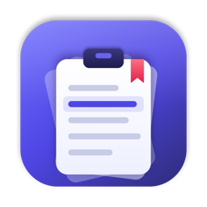
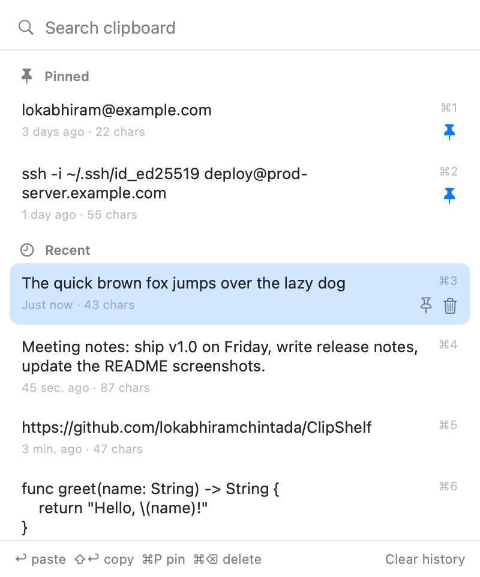
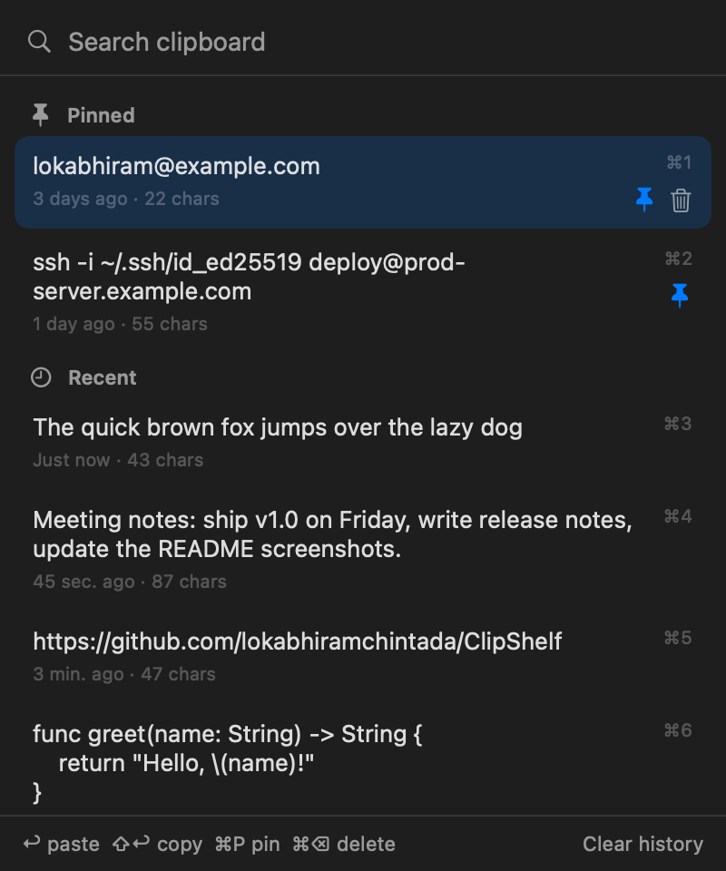

<p align="center">
  
</p>

<h1 align="center">ClipShelf</h1>

<p align="center">
  A fast, private clipboard history for macOS — like <kbd>Win</kbd>+<kbd>V</kbd> on Windows.<br>
  Press <kbd>⇧⌘V</kbd>, pick something you copied earlier, and it's pasted right where you're typing.
</p>

<p align="center">
  
  
</p>

## Features

- **Clipboard history** — every piece of text you copy, newest first (50 to 1,000 items, your choice).
- **Pin what you reuse** — pinned items stay at the top, survive "Clear history", and are never trimmed.
- **Paste anywhere** — choose an item and it's pasted into the app you were using, without switching windows.
- **Keyboard first** — search as you type, arrow keys to move, <kbd>⌘1</kbd>–<kbd>⌘9</kbd> to paste instantly.
- **Private** — everything stays on your Mac in a single JSON file. No network access, no analytics.
  Passwords copied from password managers (1Password, KeePassXC and others that mark copies as concealed) are skipped automatically.
- **Lightweight** — a native Swift/SwiftUI menu bar app with no dependencies and no Dock icon.

## Install

ClipShelf requires **macOS 14 Sonoma or later** and runs natively on Apple Silicon and Intel Macs.

### Download

1. Download `ClipShelf-<version>.zip` from the [latest release](https://github.com/lokabhiramchintada/ClipShelf/releases).
2. Unzip it and drag **ClipShelf.app** into **Applications**.
3. ClipShelf isn't notarized by Apple yet, so macOS blocks it the first time. Either:
   - open it once, then go to **System Settings → Privacy & Security** and click **Open Anyway**, or
   - run `xattr -dr com.apple.quarantine /Applications/ClipShelf.app` in Terminal, then open it.

### Build from source

You only need Xcode or the Command Line Tools (`xcode-select --install`).

```bash
git clone https://github.com/lokabhiramchintada/ClipShelf.git
cd ClipShelf
./build.sh install   # builds, copies to /Applications and launches
```

### First launch

1. ClipShelf appears as a clipboard icon in the menu bar.
2. macOS asks to give ClipShelf **Accessibility** access. This is only used to press <kbd>⌘V</kbd> for you
   when you pick an item. Without it, picking an item copies it and you paste yourself.
   You can enable it later from the menu bar icon → *Enable Auto-Paste*, or in
   System Settings → Privacy & Security → Accessibility.

> **Rebuilt the app and auto-paste stopped working?** Local builds are ad-hoc signed, so macOS treats each
> build as a new app. Remove ClipShelf from the Accessibility list and add it again.

## Usage

Open ClipShelf with <kbd>⇧⌘V</kbd> or by clicking the menu bar icon.

| Action | Shortcut |
|---|---|
| Search | Just start typing |
| Move selection | <kbd>↑</kbd> <kbd>↓</kbd> (<kbd>⌘↑</kbd> <kbd>⌘↓</kbd> to jump to top/bottom) |
| Paste selected item | <kbd>↩</kbd> or click |
| Copy without pasting | <kbd>⇧↩</kbd> or <kbd>⌘C</kbd> |
| Paste item 1–9 | <kbd>⌘1</kbd> … <kbd>⌘9</kbd> |
| Pin / unpin | <kbd>⌘P</kbd> or the pin icon |
| Delete item | <kbd>⌘⌫</kbd> or the trash icon |
| Clear search, then close | <kbd>esc</kbd> |

Right-click an item for the same actions. Right-click (or <kbd>⌃</kbd>-click) the menu bar icon for settings:

- **Pause Recording** — stop saving copies temporarily.
- **Shortcut** — <kbd>⇧⌘V</kbd>, <kbd>⌃⌘V</kbd> or <kbd>⌥⌘V</kbd>. Some apps use <kbd>⇧⌘V</kbd> for
  "Paste and Match Style"; pick another shortcut if you rely on that.
- **History Size**, **Launch at Login**, **Clear History** (keeps pinned items).

## Privacy

- History is stored at `~/Library/Application Support/ClipShelf/history.json`. Delete that file to wipe it.
- ClipShelf only reads plain text. Images and files aren't recorded.
- Content marked as concealed or transient ([nspasteboard.org](http://nspasteboard.org) conventions, used by
  most password managers) is never recorded.
- The app makes no network requests.

## Development

```bash
./build.sh            # build build/ClipShelf.app
./build.sh test       # run the test suite
./build.sh install    # build, install to /Applications and launch
./build.sh release    # run tests, build a universal app and zip it in build/
scripts/make-icon.sh  # regenerate the app icon from scripts/make-icon.swift
```

`build.sh` calls `swiftc` directly, so it works with just the Command Line Tools. If your SwiftPM
installation works, `swift build` and `swift run ClipShelfTests` work too.

The tests are a small self-contained runner (the Command Line Tools ship neither XCTest nor
swift-testing). They cover the store, persistence, clipboard monitoring (on private pasteboards, so
your real clipboard is never touched), keyboard handling, selection logic and panel placement. They also
render the panel offscreen to `build/snapshots/` so UI changes can be checked visually.

### Project layout

```
Sources/
  ClipShelf/                 App entry point and menu bar (AppDelegate)
  ClipShelfCore/
    ClipItem.swift           A history entry and its display text
    ClipboardStore.swift     History, pins, trimming and persistence
    ClipboardMonitor.swift   Watches the pasteboard for new text
    PanelModel.swift         Search and selection state
    PanelCommand.swift       Keyboard shortcut mapping
    PanelPlacement.swift     Where the panel appears on screen
    PanelController.swift    The floating panel and pasting into other apps
    ClipboardView.swift      The SwiftUI interface
    HotKey.swift             Global shortcut (Carbon)
    Paster.swift             Pasteboard writes and the ⌘V keystroke
Tests/ClipShelfTests/        Test suite
Resources/                   Info.plist and app icon
scripts/                     Icon generator
```

### Contributing

Issues and pull requests are welcome. Please run `./build.sh test` before submitting, and add tests for
new behavior where possible.

## License

[MIT](LICENSE)
